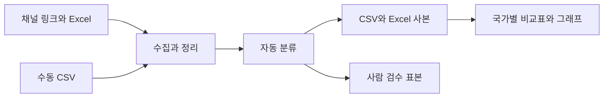

<div align="center">

# ⚡ Pokémon Brand Analysis Project

포켓몬 관련 리뷰와 콘텐츠를 분류하고 감성 분석 결과를 시각화합니다.

**기술 분류:** 자연어 처리 › 감성·콘텐츠 분류 › 규칙·다국어 모델과 검수

`Python`
`pandas`
`Jupyter`

[빠른 시작](#quick-start) · [저장소 구성](#repository-structure) · [데이터 구성](#data-settings)

[핵심 구성](#input-processing-output)

</div>

<a name="overview"></a>

## ✨ 주요 개발 내용

한·중·일 포켓몬 채널의 목적·메시지·감성·행동의도·토픽을 비교합니다.

기본 노트북의 YouTube 키는 선택 사항이며, 이전 Docker 사본의 인증 조건은 다릅니다. 2차 노트북은 수집과 분류 과정을 구성합니다.

- 채널 Excel, YouTube·홈페이지 수집, 수동 CSV를 연결하며 수동 입력 템플릿과 보완 경로를 제공합니다.
- 목적·메시지 유형·행동의도·토픽 및 감성 분류를 수행합니다. 댓글의 표본 구성이 전체 이용자 의견을 대표한다는 보장은 없습니다.
- Excel 시트 작성과 국가별 그래프·통계 비교, 수동 검토 표본 및 Cohen kappa 계산 경로를 포함합니다.

**자료별 안내:** [1차](docs/versions/first.md) · [2차](docs/versions/latest.md) · [전체 기록](docs/VERSIONS.md)

<a name="preview"></a>

<a name="input-processing-output"></a>

## 🔄 입력·처리·출력

| 단계 | 이 프로젝트에서 다루는 내용 |
| :--- | :--- |
| 📥 입력 | 브랜드 리뷰·한중일 콘텐츠·수동 CSV |
| ⚙️ 처리 | 규칙 또는 선택 언어 모델·다국어 감성 분류, 통계와 검수 |
| 📤 출력 | 분류 CSV·Excel·비교 그래프 |


---

<a name="introduction"></a>

## ✨ 프로젝트 소개

브랜드 리뷰와 포켓몬 콘텐츠를 어떻게 비교할 수 있을지 살펴보는 분석 프로젝트입니다.

1차 노트북은 리뷰 수집·별점 또는 감성 점수·소셜 NPS 계산을 연결합니다. 2차 노트북은 한국·중국·일본의 채널 링크를 입력으로 콘텐츠를 수집하고, 분류 결과를 CSV와 Excel 사본에 저장해 비교 분석합니다.

| 기능 | 구현 내용 |
| :--- | :--- |
| 리뷰 수집 | 정적 웹 페이지·게시판 또는 수동 CSV 입력 |
| 콘텐츠 수집 | 홈페이지, YouTube API, 선택적 수집 도구 |
| 자동 분류 | 캠페인 목적·메시지 유형·감성·행동의도·토픽 |
| 표 채우기 | 원본 Excel을 복사해 결과 작성 |
| 시각화 | 데이터 현황·비교표·그래프 생성 |
| 검수 보조 | 사람 검수용 표본과 Cohen's κ 계산 함수 |



<a name="repository-structure"></a>

## 📁 저장소 구성

```text
.
├── 1차/
│   └── brand_nps_auto_pipeline_v2.ipynb
├── 2차/
│   ├── 포켓몬30주년_올인원.ipynb
│   └── 포켓몬30주년_올인원_이전도커버전.ipynb
├── docs/VERSIONS.md
└── CHANGELOG.md
```

- [브랜드 리뷰 분석](1차/brand_nps_auto_pipeline_v2.ipynb).
- [한·중·일 콘텐츠 분석](2차/포켓몬30주년_올인원.ipynb).
- [이전 Docker 버전](2차/포켓몬30주년_올인원_이전도커버전.ipynb).
- [버전 기록](docs/VERSIONS.md).

<a name="implementation"></a>

## 🧩 주요 기술

수집한 자료는 어떻게 표와 그래프가 될까요? requests·BeautifulSoup으로 웹 자료를 읽고 pandas로 표를 구성합니다. openpyxl은 Excel 사본 작성, Matplotlib은 그래프를 담당합니다. 선택적 기능으로 yt-dlp, 다국어 감성 모델, Playwright를 사용하는 경로가 있습니다.

원본 노트북은 자동 분류를 1차 코딩으로 취급합니다. 모델·사전의 결과를 사람이 검수한 정답과 동일하게 간주하지 않고, 검수 표본과 분류 일치도를 함께 확인하도록 구성합니다.

### 🔎 실제 차수별 분석 방식

1차는 식품 브랜드 리뷰를 입력으로 사용한 선행 실험입니다. 실제 별점이 있으면 우선 사용하고, 없을 때 키워드 또는 선택한 Gemini API로 1~5점을 추정합니다. 4~5점을 추천, 3점을 중립, 1~2점을 비추천으로 묶어 반올림한 두 비율의 차를 계산합니다. 이는 0~10점 추천의향 설문을 직접 받은 지표가 아닙니다.

키워드 점수의 실제 구간은 합계 5 이상→5점, 2~4→4점, -1~1→3점, -4~-2→2점, 그 밖→1점입니다. 노트북 앞부분의 이전 설명표와 차이가 있으므로 함수의 값을 기준으로 확인해야 합니다. LLM 경로는 모든 리뷰 본문을 외부 API에 보내고, 재시도·배치 분할 후에도 한 건이 실패하면 3점으로 처리합니다. 분류 실패의 대체값도 집계에 포함되므로, 원로그에서 실패 건수와 중립 반응을 따로 확인할 수 있습니다.

2차는 홈페이지·SNS·댓글의 한·중·일 비교입니다. 캠페인 목적 3종, 제안 4종, 내부자형/초대형, 감성 -1/0/1, 행동의도 O/X, 토픽을 분류합니다. 감성 모델은 선택 사항이며 로드 실패 시 사전 방식으로 전환합니다. 수동 CSV에 유효한 분류값이 있으면 그 값을 우선합니다.

두 2차 노트북의 코드·Markdown 차이는 인증 환경변수와 동일 시작일의 중복 선언입니다. 기본 파일은 `YOUTUBE_API_KEY`를 선택적으로 읽어 없으면 YouTube를 건너뛰고, 이전 Docker 사본은 `GOOGLE_API_KEY`가 없으면 `KeyError`로 중단합니다. 이전 Docker 이름이 별도 컨테이너 실행 환경의 포함을 뜻하지는 않습니다.

<a name="quick-start"></a>

## 🚀 빠른 시작

```powershell
python -m pip install jupyterlab requests beautifulsoup4 pandas openpyxl matplotlib scipy
python -m jupyter lab "2차/포켓몬30주년_올인원.ipynb"
```

1. 노트북에서 기대하는 원본 Excel 6개를 준비하고 `DATA_DIR`을 맞춥니다.
2. 수집할 채널 링크와 기간을 확인합니다. YouTube 수집에는 본인의 `YOUTUBE_API_KEY`가 필요합니다.
3. 자동 수집을 지원하지 않는 자료는 `manual/`의 CSV 입력 흐름을 사용합니다.
4. 사용할 선택 기능의 패키지를 준비하고, 수집→분류→표 작성→분석 순서로 실행합니다.

1차의 LLM 경로는 `GOOGLE_API_KEY`와 `google-genai`가 필요하며, API 모델의 제공 여부와 사용 조건은 실행 환경에서 확인해야 합니다. 1차 패키지 설치와 2차 글꼴 설정에는 pip·apt 설치를 시도하는 셀이 있으므로 실행할 셀을 먼저 확인하세요.

이미 분류된 자료만 다시 분석할 때는 설정 셀과 분석 구간을 사용합니다. 원본 Excel·댓글·리뷰 데이터와 API 키는 별도로 준비해야 합니다.

<a name="data-settings"></a>

## 📊 데이터 구성과 분석 설정

| 설정·출력 | 2차 노트북의 기본 구성 |
| :--- | :--- |
| 국가 순서 | 한국·중국·일본 |
| 수집 시작일 | `2026-01-01` |
| 종료일 | `None`: 실행 당시 날짜 사용 |
| 채널당 영상 상한 | 100 |
| 영상당 댓글 상한 | 30 |
| 댓글 정렬 | `relevance` |
| 분류 결과 | `data/` |
| Excel 사본 | `수집결과/` |
| 수동 입력 | `manual/` |

상한·정렬·수집 가능 채널이 표본에 영향을 줍니다. 1차의 소셜 NPS는 리뷰·감성 점수를 바탕으로 계산하며, 정식 추천의향 설문 기반 NPS와 측정 방법이 다릅니다.

### 📊 지표와 검수

| 산출물·지표 | 계산과 해석 |
| :--- | :--- |
| 참여율 | `(좋아요 + 댓글 + 공유) / 조회수 × 100`; 조회수 0·결측은 제외 |
| YouTube 공유수 | 제공되지 않는 값을 0으로 기록하므로 실제 공유 0과 구분 |
| 표·그래프 | 데이터 현황·핵심 지표·통계 검정 표 3개와 PNG 그래프 10개 |
| 행동의도 구간 | 국가별 비율과 95% Wilson 신뢰구간 |
| 범주 비교 | 카이제곱·Cramér's V, 작은 기대빈도 경고 |
| 분포 비교 | Kruskal–Wallis·ε²와 국가 쌍별 Mann–Whitney U·Bonferroni 보정 |
| 관계 분석 | 게시물 참여율과 댓글 평균 감성의 Spearman 상관 |
| 검수 표본 | 국가별 댓글 최대 50개, 게시물·홈페이지 각각 최대 14개 |

`human_*` 열을 사람이 채운 뒤 Cohen's κ를 계산합니다. 기본 게시물·홈페이지 표본은 국가별 14개씩이라 각 최대 42개이며, 실제 수는 확보한 자료에 따라 줄어듭니다. 부분적으로만 검수한 파일은 κ의 유효쌍과 일치율의 분모가 달라질 수 있어 표본을 확인해야 합니다.

### 🧭 수집과 재실행의 한계

공식 채널·인기순 댓글 중심의 비확률 표본이므로 국가별 소비자 전체를 대표하거나 인과관계를 입증하는 결과가 아닙니다. 홈페이지에는 SNS와 같은 기간 필터가 적용되지 않으며, robots.txt 조회 실패는 허용으로 처리됩니다. URL 정규화는 대소문자를 바꾸므로 대소문자 구별이 필요한 게시물 식별자의 연결을 확인해야 합니다.

원본 Excel을 복사해서 쓰지만 같은 이름의 출력 Excel·CSV·검수 표본은 재실행 시 다시 작성됩니다. 사람이 채운 검수 파일은 별도 보존한 뒤 실행하세요. 

<a name="troubleshooting"></a>

## 🛠️ 문제 해결

| 증상 | 확인할 내용 |
| :--- | :--- |
| Excel 파일을 찾지 못함 | `DATA_DIR`과 입력 파일·시트 구조 |
| YouTube 수집 실패 | API 키·서비스 사용 설정·쿼터 |
| 웹 수집 결과가 비어 있음 | 페이지 구조·자바스크립트 렌더링·접근 조건 |
| 특정 채널을 수집하지 못함 | 공식 API 지원과 수동 CSV 경로 |
| 감성 결과가 예상과 다름 | 모델 사용 여부·사전 대체·사람 검수 표본 |
| 그래프 한글 오류 | 폰트 설치와 노트북의 폰트 설정 |

---

<div align="center">

**수집 조건을 남기고, 자동 분류를 검수하며 비교합니다.**

</div>
