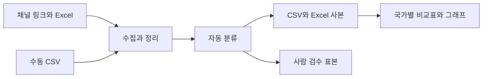

# Pokemon-Brand-Analysis-Project — LEVEL 1 - Beginner

**읽기 수준 선택** · **LEVEL 1 - Beginner** · [LEVEL 2 - Explorer](%EB%A0%88%EB%B2%A82.md) · [LEVEL 3 - Practitioner](%EB%A0%88%EB%B2%A83.md) · [LEVEL 4 - Advanced](%EB%A0%88%EB%B2%A84.md) · [LEVEL 5 - Expert](%EB%A0%88%EB%B2%A85.md)

[같은 수준 프로필](https://github.com/PUVKID/PUVKID/blob/main/docs/읽기안내/레벨1.md) · [저장소 첫 화면](../../README.md)

<a id="guide-intro"></a>

## 프로젝트 소개

**포켓몬 관련 리뷰와 한·중·일 채널 콘텐츠를 모아 반응과 주제를 살펴보는 분석입니다.** 글을 모으는 일, 점수를 붙이는 일, 나라별 차이를 해석하는 일은 서로 다른 단계입니다. **공식 채널·인기 댓글의 표본을 소비자 전체의 의견으로 보지 않습니다.**

<a id="guide-problem"></a>

## 문제와 주요 기능

사람들이 어떤 말을 남기는지 읽고 비슷한 반응을 모으려는 작업입니다. 1~5점은 글에서 추정한 점수입니다. 사용자에게 추천 의향을 직접 물어 받은 0~10점 설문과는 다릅니다.

<a id="guide-flow"></a>

## 입력·처리·출력

글을 모은 뒤 키워드나 선택한 언어 모델로 점수를 붙이고, 결과를 표로 정리합니다. 2차에서는 댓글·게시물·홈페이지 자료를 모아 분류·시트·통계로 연결합니다. 같은 행이 여러 의미의 완료 건수를 뜻하는 것은 아닙니다.

<a id="guide-practice"></a>

## 실험과 사용 흐름

저장된 자료와 결과를 먼저 보고 필요한 노트북을 고릅니다. API 경로를 실행하면 글이 외부로 전송될 수 있습니다. 표를 읽는 것과 새로운 수집·분류를 실행하는 것은 다릅니다.

<a id="guide-results"></a>

## 관측 결과와 해석

보관된 data는 댓글 5585행·게시물 400행·홈페이지 73행입니다. 검수 표본 파일은 각각 100행·28행·35행입니다. 이 표본 수가 모두 사람이 검수를 마친 수라는 뜻은 아닙니다.

<a id="guide-architecture"></a>

## 구현과 핵심 파일

노트북은 수집과 점수 계산을 이어 보여 주고, 자료 파일은 모은 글과 표본을 담습니다. 그래프는 그 자료를 요약한 모습입니다. 원문을 모으는 코드와 정답을 확인하는 사람 검수는 다른 역할입니다.

<a id="guide-paper"></a>

## 실제 논문과 원고

분석 결과와 실행 자료는 아래 두 차수 설명에서 읽을 수 있습니다. 실제로 있는 원고·발표와 파일만 자료로 셉니다. 코드나 그래프가 있다는 이유로 정식 논문이 게재됐다고 덧붙이지 않습니다.

<a id="guide-limits"></a>

## 조건·실패·미검증 한계

일부 글을 골라 읽은 결과이므로 모든 나라 사람의 생각을 대표하지 않습니다. API 실패의 3점은 실제 사람이 중립 의견을 준 것과 다릅니다. 홈페이지와 SNS의 수집 기간도 다를 수 있습니다.

## 전체 차수

차수는 아래의 실제 자료 구분을 따릅니다. 설명은 현재 선택한 수준으로 열리며, 자료 폴더와 당시 전체 비교도 함께 확인할 수 있습니다.

| 내용 |
| --- |
| **차수·단계**<br>1차<br><br>**같은 수준 설명**<br>[LEVEL 1 - Beginner](../revisions/step-1.md#reading-level-1)<br><br>**자료 폴더**<br>[자료](../../1%EC%B0%A8)<br><br>**직전 비교·구성**<br>[전체 비교](../revisions/step-1.patch) |
| **차수·단계**<br>2차<br><br>**같은 수준 설명**<br>[LEVEL 1 - Beginner](../revisions/step-2.md#reading-level-1)<br><br>**자료 폴더**<br>[자료](../../2%EC%B0%A8)<br><br>**직전 비교·구성**<br>[전체 비교](../revisions/step-2.patch) |

## 첫 화면의 모든 설명과 공통 근거

아래는 기존 첫 화면의 실질 구성 전체입니다. 각 항목의 개념은 이 페이지의 풀이와 연결하고, 실제 표·코드·그림·상세 조건은 원문 공통 근거에서 확인합니다. 기존 전체 비교는 문장·주석·파일 단위의 작은 변화까지 보존하는 자료입니다.

| 내용 |
| --- |
| **첫 화면 구성**<br>구현 요약<br><br>**이 수준의 풀이**<br>[프로젝트 소개](#guide-intro)<br><br>**원문 공통 근거**<br>[전체 설명·표·그림](../../README.md#-%EC%A3%BC%EC%9A%94-%EA%B0%9C%EB%B0%9C-%EB%82%B4%EC%9A%A9) |
| **첫 화면 구성**<br>입력·처리·출력<br><br>**이 수준의 풀이**<br>[입력·처리·출력](#guide-flow)<br><br>**원문 공통 근거**<br>[전체 설명·표·그림](../../README.md#-%EC%9E%85%EB%A0%A5%EC%B2%98%EB%A6%AC%EC%B6%9C%EB%A0%A5) |
| **첫 화면 구성**<br>전체 차수<br><br>**이 수준의 풀이**<br>[문제와 주요 기능](#guide-problem)<br><br>**원문 공통 근거**<br>[전체 설명·표·그림](../../README.md#%EF%B8%8F-%EC%B0%A8%EC%88%98%EB%B3%84-%ED%94%84%EB%A1%9C%EC%A0%9D%ED%8A%B8-%EC%95%88%EB%82%B4) |
| **첫 화면 구성**<br>연구 방법<br><br>**이 수준의 풀이**<br>[2차 수집과 자동 분류의 준비](#semantic-collection-level-1)<br><br>**원문 공통 근거**<br>[전체 설명·표·그림](../../README.md#-%ED%94%84%EB%A1%9C%EC%A0%9D%ED%8A%B8-%EC%86%8C%EA%B0%9C) |
| **첫 화면 구성**<br>저장소 구성<br><br>**이 수준의 풀이**<br>[구현과 핵심 파일](#guide-architecture)<br><br>**원문 공통 근거**<br>[전체 설명·표·그림](../../README.md#-%EC%A0%80%EC%9E%A5%EC%86%8C-%EA%B5%AC%EC%84%B1) |
| **첫 화면 구성**<br>주요 기술<br><br>**이 수준의 풀이**<br>[2차 수집과 자동 분류의 준비](#semantic-collection-level-1)<br><br>**원문 공통 근거**<br>[전체 설명·표·그림](../../README.md#-%EC%A3%BC%EC%9A%94-%EA%B8%B0%EC%88%A0) |
| **첫 화면 구성**<br>빠른 시작<br><br>**이 수준의 풀이**<br>[2차 수집과 자동 분류의 준비](#semantic-collection-level-1)<br><br>**원문 공통 근거**<br>[전체 설명·표·그림](../../README.md#-%EB%B9%A0%EB%A5%B8-%EC%8B%9C%EC%9E%91) |
| **첫 화면 구성**<br>데이터 구성과 분석 설정<br><br>**이 수준의 풀이**<br>[2차 수집과 자동 분류의 준비](#semantic-collection-level-1)<br><br>**원문 공통 근거**<br>[전체 설명·표·그림](../../README.md#-%EB%8D%B0%EC%9D%B4%ED%84%B0-%EA%B5%AC%EC%84%B1%EA%B3%BC-%EB%B6%84%EC%84%9D-%EC%84%A4%EC%A0%95) |
| **첫 화면 구성**<br>문제 해결<br><br>**이 수준의 풀이**<br>[재실행·수집 실패와 해석의 한계](#semantic-limitations-level-1)<br><br>**원문 공통 근거**<br>[전체 설명·표·그림](../../README.md#%EF%B8%8F-%EB%AC%B8%EC%A0%9C-%ED%95%B4%EA%B2%B0) |
| **첫 화면 구성**<br>원문 수집·분석 자료<br><br>**이 수준의 풀이**<br>[사람 검수와 저장 결과의 의미](#semantic-human-level-1)<br><br>**원문 공통 근거**<br>[전체 설명·표·그림](../../README.md#-%EC%9B%90%EB%AC%B8-%EC%88%98%EC%A7%91%EB%B6%84%EC%84%9D-%EC%9E%90%EB%A3%8C) |
| **첫 화면 구성**<br>차수별 방법과 조건<br><br>**이 수준의 풀이**<br>[재실행·수집 실패와 해석의 한계](#semantic-limitations-level-1)<br><br>**원문 공통 근거**<br>[전체 설명·표·그림](../../README.md#-%EC%97%B0%EA%B5%AC%EA%B5%AC%ED%98%84%EC%9D%98-%EC%84%B8%EB%B6%80-%ED%9D%90%EB%A6%84) |

## 이어 읽기

같은 난이도로 다른 프로젝트를 찾으려면 [프로필의 LEVEL 1 - Beginner](https://github.com/PUVKID/PUVKID/blob/main/docs/읽기안내/레벨1.md)를 엽니다. 이 저장소 안에서는 위 전체 차수 표의 같은 수준 설명으로 이동하세요. 단계별 선택표에서 깊이를 바꿀 수 있으며, LEVEL 5 아래에는 기존 상세 전체가 보존되어 있습니다.

<!-- semantic-explanation17:start -->

## LEVEL 1 · 조건과 절차를 상세히 읽기

<a id="semantic-review-level-1"></a>

### LEVEL 1 · 1차 식품 리뷰의 점수와 소셜 NPS

리뷰의 별점이 있으면 그 점수를 먼저 읽고 없을 때만 문장으로 점수를 추정합니다. **3점 안에는 실제 중립뿐 아니라 API 실패도 들어갈 수 있습니다.** 추천 비율에서 비추천 비율을 뺀 값이 어떤 입력과 규칙에서 나왔는지 먼저 확인하세요.

<a id="layout18-table-3-row-1"></a>

**1차 입력과 점수 우선순위**

**조건·자료**

1차 입력과 점수 우선순위

**의미와 확인 방법**

선행 실험의 입력은 식품 브랜드 리뷰입니다. 실제 별점이 있으면 우선 쓰고 없으면 키워드 또는 선택 Gemini API로1~5점을 추정합니다.2차 포켓몬 콘텐츠와 다른 대상입니다.

<a id="layout18-table-3-row-2"></a>

**키워드 함수의 구간**

**조건·자료**

키워드 함수의 구간

**의미와 확인 방법**

가중치 합계≥5→5점,2~4→4점,-1~1→3점,-4~-2→2점,그 밖→1점입니다. 앞의 이전 설명표와 달라 실제 함수를 기준으로 읽습니다. 처음 찾은 위치 중심 가중치·간단한 부정어 규칙이며 모든 반복 횟수를 세는 방식은 아닙니다.

<a id="layout18-table-3-row-3"></a>

**추천·중립·비추천 집계**

**조건·자료**

추천·중립·비추천 집계

**의미와 확인 방법**

4~5점은 추천,3점은 중립,1~2점은 비추천입니다. 반올림한 추천 비율과 비추천 비율의 차를 계산합니다.0~10점 추천의향 설문을 직접 받아 계산한 정식 NPS와 측정 방법이 다릅니다.

<a id="layout18-table-3-row-4"></a>

**선택 LLM 경로**

**조건·자료**

선택 LLM 경로

**의미와 확인 방법**

google-genai·GOOGLE_API_KEY가 필요하고 모든 리뷰 본문을 외부 API에 보냅니다. 재시도·배치 분할 후에도 실패하면3점을 넣으므로 실패 대체값이 실제 중립 반응에 섞입니다. 로그에서 실패 건수를 구분해야 합니다.


<a id="semantic-collection-level-1"></a>

### LEVEL 1 · 2차 수집과 자동 분류의 준비

**1차는 식품 리뷰,2차는 한·중·일 포켓몬 채널 자료입니다.** 이미 보관된 표를 읽는 일과 새로 자료를 모으는 일은 다릅니다. 먼저Excel6개와 폴더를 맞추고 사용할 채널·기간·선택 기능을 고른 뒤 순서대로 실행하세요.

<a id="layout18-table-4-row-1"></a>

**준비와 실행 순서**

**조건·자료**

준비와 실행 순서

**의미와 확인 방법**

2차는 한국·중국·일본 홈페이지/SNS/댓글을 비교합니다.원본 Excel6개와 DATA_DIR,채널 링크·기간을 확인하고 수집→분류→표작성→분석 순서로 진행합니다.미지원 자료는 manual/ CSV로 넣습니다.

<a id="layout18-table-4-row-2"></a>

**도구 역할**

**조건·자료**

도구 역할

**의미와 확인 방법**

requests는 문서 요청,BeautifulSoup은 페이지에서 내용 추출,pandas는 표 처리,openpyxl은 Excel,Matplotlib은 그래프를 맡습니다.선택 yt-dlp·감성모델·Playwright는 실행 경로에 따라 필요하며 사람 검수의 정답을 대신하지 않습니다.

<a id="layout18-table-4-row-3"></a>

**기간·표본 상한**

**조건·자료**

기간·표본 상한

**의미와 확인 방법**

기본 국가 순서는 한국·중국·일본,시작2026-01-01,종료None은 실행 당시 날짜입니다.채널당 영상 최대100,영상당 댓글 최대30,relevance 정렬이 수집 표본을 제한합니다.

<a id="layout18-table-4-row-4"></a>

**분류 값**

**조건·자료**

분류 값

**의미와 확인 방법**

캠페인 목적3종·제안4종·내부자형/초대형·감성-1/0/1·행동의도 O/X·토픽을 정리합니다.선택 감성모델이 로드 실패하면 사전 방식으로 바꾸고 유효한 수동 CSV 분류값이 있으면 우선합니다.

<a id="layout18-table-4-row-5"></a>

**인증·실행 사본 차이**

**조건·자료**

인증·실행 사본 차이

**의미와 확인 방법**

기본2차는 YOUTUBE_API_KEY가 없으면 YouTube 수집을 건너뜁니다.이전 Docker 이름 사본은 GOOGLE_API_KEY가 없으면 KeyError로 중단합니다.Docker 이름이 컨테이너 환경 포함을 뜻하지 않습니다.pip/apt 설치·폰트 셀도 실행 전에 확인합니다.


<a id="semantic-statistics-level-1"></a>

### LEVEL 1 · 비율·검정·관계 분석을 구분하기

같은 표에서도 **비율,나라 간 차이,두 값의 관계는 다른 질문**입니다.공유수0은 미제공 때문에 적힌 값일 수 있으니 실제 반응0으로 해석하지 마세요.구간은 비율의 불확실성을 나타내며 한 숫자로 모든 나라의 소비자를 설명하지 않습니다.

<a id="layout18-table-5-row-1"></a>

**참여율**

**조건·자료**

참여율

**의미와 확인 방법**

(좋아요+댓글+공유)/조회수×100입니다.조회수0·결측은 제외합니다.YouTube는 공유수를 제공하지 않아0으로 기록하므로 실제 공유가0이었다는 관측과 다릅니다.

<a id="layout18-table-5-row-2"></a>

**행동의도와 범주 비교**

**조건·자료**

행동의도와 범주 비교

**의미와 확인 방법**

95% Wilson 구간은 국가별 비율의 불확실성을 봅니다.카이제곱은 범주 구성 차이,Cramér’s V는 그 관련 크기를 봅니다.작은 기대빈도 경고가 있으면 검정 해석을 함께 점검해야 합니다.

<a id="layout18-table-5-row-3"></a>

**분포와 국가 쌍 비교**

**조건·자료**

분포와 국가 쌍 비교

**의미와 확인 방법**

Kruskal–Wallis·ε²는 국가 간 분포 비교와 효과 크기,Mann–Whitney U는 국가쌍 비교,Bonferroni는 여러 비교를 한 데 따른 보정입니다.

<a id="layout18-table-5-row-4"></a>

**상관과 산출물**

**조건·자료**

상관과 산출물

**의미와 확인 방법**

Spearman은 게시물 참여율과 댓글 평균 감성의 관계를 살핍니다.표3개·PNG그래프10개가 현황·지표·검정 결과를 보여 줍니다.관계가 있다는 사실이 캠페인의 인과 효과를 증명하지는 않습니다.


<a id="semantic-human-level-1"></a>

### LEVEL 1 · 사람 검수와 저장 결과의 의미

**표본을 뽑아 놓은 것과 사람이 판정한 것은 다릅니다.** 원문과 자동 분류를 읽고human열을 채운 뒤에야 사람의 판단과 비교할 수 있습니다.그래프만 보기 전에 어느 자료를 몇 건 검수했는지 확인하세요.

<a id="layout18-table-6-row-1"></a>

**보관 자료와 표본**

**조건·자료**

보관 자료와 표본

**의미와 확인 방법**

댓글 data5585행/검수표본100행,게시물400/28,홈페이지73/35입니다.표본 파일 행 수는 사람이 검수 완료한 건수가 아닙니다.

<a id="layout18-table-6-row-2"></a>

**표본 상한과 human_***

**조건·자료**

표본 상한과 human_*

**의미와 확인 방법**

국가별 댓글 최대50개,게시물·홈페이지 각각 최대14개를 뽑습니다.후자 두 자료는 각각3개국 최대42개이며 확보량에 따라 줄어듭니다.사람이 human_*열을 채운 뒤 검수 지표를 계산합니다.

<a id="layout18-table-6-row-3"></a>

**Cohen’s κ와 일치율**

**조건·자료**

Cohen’s κ와 일치율

**의미와 확인 방법**

κ는 우연 일치를 고려한 분류 일치 지표입니다.일부만 채운 파일에서는 κ의 유효쌍과 일치율 분모가 달라질 수 있으므로 실제 채운 표본과 분모를 확인합니다.

<a id="layout18-table-6-row-4"></a>

**폴더별 자료 역할**

**조건·자료**

폴더별 자료 역할

**의미와 확인 방법**

data/는 수집CSV·검수표본,수집결과/는 국가별Excel사본,결과/분석결과_통합.xlsx는 통합분석,결과/figures/는10그래프,manual/은 수동입력입니다.자동분류와 사람 정답을 구분해 읽습니다.


<a id="semantic-limitations-level-1"></a>

### LEVEL 1 · 재실행·수집 실패와 해석의 한계

같은 노트북을 다시 실행해도 날짜·채널 접근·파일이 달라질 수 있습니다. **사람이 고친 검수파일을 먼저 보관**하세요.자료가 비면 경로나 접근조건을 확인하고,없는 의견을0점이나 국가전체의 반응으로 만들지 않습니다.

<a id="layout18-table-7-row-1"></a>

**대표성과 기간**

**조건·자료**

대표성과 기간

**의미와 확인 방법**

공식채널·인기순댓글 중심의 비확률 표본입니다.국가 전체 소비자를 대표하지 않습니다.홈페이지에는 SNS와 같은 기간필터가 적용되지 않습니다.

<a id="layout18-table-7-row-2"></a>

**접근과 정규화**

**조건·자료**

접근과 정규화

**의미와 확인 방법**

robots.txt 조회 실패는 허용으로 처리됩니다.URL 정규화는 대소문자를 바꾸므로 대소문자를 구분하는 게시물ID의 링크가 맞는지 확인해야 합니다.

<a id="layout18-table-7-row-3"></a>

**재작성되는 파일**

**조건·자료**

재작성되는 파일

**의미와 확인 방법**

원본Excel사본을 사용하지만 같은이름 출력Excel·CSV·검수표본은 재실행시 다시 씁니다.사람이 채운 검수파일은 먼저 별도 보존합니다.

<a id="layout18-table-7-row-4"></a>

**증상별 확인점**

**조건·자료**

증상별 확인점

**의미와 확인 방법**

Excel오류는 DATA_DIR·파일/시트,YouTube실패는 키·서비스설정·쿼터,빈 웹수집은 페이지구조·JS·접근조건을 확인합니다.미지원채널은 manual CSV,감성차이는 모델/사전/사람표본,한글오류는 폰트설정을 봅니다.


<!-- semantic-explanation17:end -->

<!-- complete-source-facts17:start -->

## 첫 화면의 세부 사실을 빠짐없이 읽기

위의 수준별 풀이에 대응하는 실제 세부 사실입니다. 입력·조건·수치·표·그림·문서 판본과 작은 변경까지 같은 페이지에서 확인하도록 기존 첫 화면의 내용을 함께 수록했습니다. 각 절은 해당 수준의 앞선 설명과 연결해 읽으며, 원래 실행 코드·전체 비교·원고는 원문 주소로 이어집니다.

<a id="facts-section-0"></a>

### LEVEL 1 · 첫 화면 기본 정보


포켓몬 관련 리뷰와 콘텐츠를 분류하고 감성 분석 결과를 시각화합니다.

분야: 자연어 처리 › 감성·콘텐츠 분류 › 규칙·다국어 모델과 검수

`Python`
`pandas`
`Jupyter`

[빠른 시작](../../README.md#quick-start) · [저장소 구성](../../README.md#repository-structure) · [데이터 구성](../../README.md#data-settings)

[전체 차수 목차](../../docs/REVISION_INDEX.md) ·
[핵심 구성](../../README.md#input-processing-output)


<a id="facts-section-1"></a>

### LEVEL 1 · 구현 요약


한·중·일 포켓몬 채널의 목적·메시지·감성·행동의도·토픽을 비교합니다.

기본 노트북의 YouTube 키는 선택 사항이며, 이전 Docker 사본의 인증 조건은 다릅니다. 2차 노트북은 수집과 분류 과정을 구성합니다.

- 채널 Excel, YouTube·홈페이지 수집, 수동 CSV를 연결하며 수동 입력 템플릿과 보완 경로를 제공합니다.
- 목적·메시지 유형·행동의도·토픽 및 감성 분류를 수행합니다. 댓글의 표본 구성이 전체 이용자 의견을 대표한다는 보장은 없습니다.
- Excel 시트 작성과 국가별 그래프·통계 비교, 수동 검토 표본 및 Cohen kappa 계산 경로를 포함합니다.

**자료별 안내:** [1차](../../docs/versions/first.md) · [2차](../../docs/versions/latest.md) · [전체 기록](../../docs/VERSIONS.md)


<a id="facts-section-2"></a>

### LEVEL 1 · 입력·처리·출력


**구분**

문제

**내용**

국가별 공식 채널과 댓글에서 콘텐츠 유형과 반응의 차이를 분석합니다.


**구분**

입력

**내용**

브랜드 리뷰·한중일 콘텐츠·수동 CSV


**구분**

처리

**내용**

규칙 또는 선택 언어 모델·다국어 감성 분류, 통계와 검수


**구분**

출력

**내용**

분류 CSV·Excel·비교 그래프


---


<a id="facts-section-3"></a>

### LEVEL 1 · 전체 차수


<a id="layout18-table-9-row-1"></a>

**[1차](../../docs/revisions/step-1.md#reading-level-1)**

**차수·단계**

[1차](../../docs/revisions/step-1.md#reading-level-1)

**주요 내용**

브랜드 리뷰를 수집하고 별점 또는 감성 점수로 추천·중립·비추천 비율을 계산하는 선행 분석 노트북입니다. 식품 브랜드 리뷰를 입력으로 사용한 실험 흐름을 담았습니다.

**자료**

[폴더](../../1%EC%B0%A8)

**직전 비교**

[전체 비교](../../docs/revisions/step-1.patch)

<a id="layout18-table-9-row-2"></a>

**[2차](../../docs/revisions/step-2.md#reading-level-1)**

**차수·단계**

[2차](../../docs/revisions/step-2.md#reading-level-1)

**주요 내용**

한국·중국·일본의 홈페이지·SNS·댓글을 수집하거나 수동 CSV로 보완하고 목적·메시지·감성·행동의도·토픽을 비교하는 분석 단계입니다.

**자료**

[폴더](../../2%EC%B0%A8)

**직전 비교**

[전체 비교](../../docs/revisions/step-2.patch)


<a id="facts-section-4"></a>

### LEVEL 1 · 연구 방법


브랜드 리뷰와 포켓몬 콘텐츠를 어떻게 비교할 수 있을지 살펴보는 분석 프로젝트입니다.

1차 노트북은 리뷰 수집·별점 또는 감성 점수·소셜 NPS 계산을 연결합니다. 2차 노트북은 한국·중국·일본의 채널 링크를 입력으로 콘텐츠를 수집하고, 분류 결과를 CSV와 Excel 사본에 저장해 비교 분석합니다.

**기능**

리뷰 수집

**구현 내용**

정적 웹 페이지·게시판 또는 수동 CSV 입력


**기능**

콘텐츠 수집

**구현 내용**

홈페이지, YouTube API, 선택적 수집 도구


**기능**

자동 분류

**구현 내용**

캠페인 목적·메시지 유형·감성·행동의도·토픽


**기능**

표 채우기

**구현 내용**

원본 Excel을 복사해 결과 작성


**기능**

시각화

**구현 내용**

데이터 현황·비교표·그래프 생성


**기능**

검수 보조

**구현 내용**

사람 검수용 표본과 Cohen's κ 계산 함수





<a id="facts-section-5"></a>

### LEVEL 1 · 저장소 구성


```text
.
├── 1차/
│   └── brand_nps_auto_pipeline_v2.ipynb
├── 2차/
│   ├── 포켓몬30주년_올인원.ipynb
│   └── 포켓몬30주년_올인원_이전도커버전.ipynb
├── docs/VERSIONS.md
└── CHANGELOG.md
```

- [브랜드 리뷰 분석](../../1차/brand_nps_auto_pipeline_v2.ipynb).
- [한·중·일 콘텐츠 분석](../../2차/포켓몬30주년_올인원.ipynb).
- [이전 Docker 버전](../../2차/포켓몬30주년_올인원_이전도커버전.ipynb).
- [버전 기록](../../docs/VERSIONS.md).


<a id="facts-section-6"></a>

### LEVEL 1 · 주요 기술


requests·BeautifulSoup으로 웹 자료를 읽고 pandas로 표를 구성합니다. openpyxl은 Excel 사본 작성, Matplotlib은 그래프를 담당합니다. 선택적 기능으로 yt-dlp, 다국어 감성 모델, Playwright를 사용하는 경로가 있습니다.

원본 노트북은 자동 분류를 1차 코딩으로 취급합니다. 모델·사전의 결과를 사람이 검수한 정답과 동일하게 간주하지 않고, 검수 표본과 분류 일치도를 함께 확인하도록 구성합니다.


#### LEVEL 1 · 실제 차수별 분석 방식

1차는 식품 브랜드 리뷰를 입력으로 사용한 선행 실험입니다. 실제 별점이 있으면 우선 사용하고, 없을 때 키워드 또는 선택한 Gemini API로 1~5점을 추정합니다. 4~5점을 추천, 3점을 중립, 1~2점을 비추천으로 묶어 반올림한 두 비율의 차를 계산합니다.

이는 0~10점 추천의향 설문을 직접 받은 지표가 아닙니다.

키워드 점수의 실제 구간은 합계 5 이상→5점, 2~4→4점, -1~1→3점, -4~-2→2점, 그 밖→1점입니다. 노트북 앞부분의 이전 설명표와 차이가 있으므로 함수의 값을 기준으로 확인해야 합니다.

LLM 경로는 모든 리뷰 본문을 외부 API에 보내고, 재시도·배치 분할 후에도 한 건이 실패하면 3점으로 처리합니다. 분류 실패의 대체값도 집계에 포함되므로, 원로그에서 실패 건수와 중립 반응을 따로 확인할 수 있습니다.

2차는 홈페이지·SNS·댓글의 한·중·일 비교입니다. 캠페인 목적 3종, 제안 4종, 내부자형/초대형, 감성 -1/0/1, 행동의도 O/X, 토픽을 분류합니다. 감성 모델은 선택 사항이며 로드 실패 시 사전 방식으로 전환합니다. 수동 CSV에 유효한 분류값이 있으면 그 값을 우선합니다.

두 2차 노트북의 코드·Markdown 차이는 인증 환경변수와 동일 시작일의 중복 선언입니다. 기본 파일은 `YOUTUBE_API_KEY`를 선택적으로 읽어 없으면 YouTube를 건너뛰고, 이전 Docker 사본은 `GOOGLE_API_KEY`가 없으면 `KeyError`로 중단합니다. 이전 Docker 이름이 별도 컨테이너 실행 환경의 포함을 뜻하지는 않습니다.


<a id="facts-section-7"></a>

### LEVEL 1 · 빠른 시작


```powershell
python -m pip install jupyterlab requests beautifulsoup4 pandas openpyxl matplotlib scipy
python -m jupyter lab "2차/포켓몬30주년_올인원.ipynb"
```

1. 노트북에서 기대하는 원본 Excel 6개를 준비하고 `DATA_DIR`을 맞춥니다.
2. 수집할 채널 링크와 기간을 확인합니다. YouTube 수집에는 본인의 `YOUTUBE_API_KEY`가 필요합니다.
3. 자동 수집을 지원하지 않는 자료는 `manual/`의 CSV 입력 흐름을 사용합니다.
4. 사용할 선택 기능의 패키지를 준비하고, 수집→분류→표 작성→분석 순서로 실행합니다.

1차의 LLM 경로는 `GOOGLE_API_KEY`와 `google-genai`가 필요하며, API 모델의 제공 여부와 사용 조건은 실행 환경에서 확인해야 합니다. 1차 패키지 설치와 2차 글꼴 설정에는 pip·apt 설치를 시도하는 셀이 있으므로 실행할 셀을 먼저 확인하세요.

이미 분류된 자료만 다시 분석할 때는 설정 셀과 분석 구간을 사용합니다. 2차의 입력 Excel 6개와 보존된 수집 CSV·검수 표본·분석 결과를 함께 담았습니다. 새 수집에는 본인의 API 키를 준비하고, 1차 리뷰 분석에는 사용할 리뷰 입력을 별도로 지정합니다.


<a id="facts-section-8"></a>

### LEVEL 1 · 데이터 구성과 분석 설정


**설정·출력**

국가 순서

**2차 노트북의 기본 구성**

한국·중국·일본


**설정·출력**

수집 시작일

**2차 노트북의 기본 구성**

`2026-01-01`


**설정·출력**

종료일

**2차 노트북의 기본 구성**

`None`: 실행 당시 날짜 사용


**설정·출력**

채널당 영상 상한

**2차 노트북의 기본 구성**

100


**설정·출력**

영상당 댓글 상한

**2차 노트북의 기본 구성**

30


**설정·출력**

댓글 정렬

**2차 노트북의 기본 구성**

`relevance`


**설정·출력**

분류 결과

**2차 노트북의 기본 구성**

`data/`


**설정·출력**

Excel 사본

**2차 노트북의 기본 구성**

`수집결과/`


**설정·출력**

수동 입력

**2차 노트북의 기본 구성**

`manual/`


상한·정렬·수집 가능 채널이 표본에 영향을 줍니다. 1차의 소셜 NPS는 리뷰·감성 점수를 바탕으로 계산하며, 정식 추천의향 설문 기반 NPS와 측정 방법이 다릅니다.


#### LEVEL 1 · 지표와 검수

**산출물·지표**

참여율

**계산과 해석**

`(좋아요 + 댓글 + 공유) / 조회수 × 100`; 조회수 0·결측은 제외


**산출물·지표**

YouTube 공유수

**계산과 해석**

제공되지 않는 값을 0으로 기록하므로 실제 공유 0과 구분


**산출물·지표**

표·그래프

**계산과 해석**

데이터 현황·핵심 지표·통계 검정 표 3개와 PNG 그래프 10개


**산출물·지표**

행동의도 구간

**계산과 해석**

국가별 비율과 95% Wilson 신뢰구간


**산출물·지표**

범주 비교

**계산과 해석**

카이제곱·Cramér's V, 작은 기대빈도 경고


**산출물·지표**

분포 비교

**계산과 해석**

Kruskal–Wallis·ε²와 국가 쌍별 Mann–Whitney U·Bonferroni 보정


**산출물·지표**

관계 분석

**계산과 해석**

게시물 참여율과 댓글 평균 감성의 Spearman 상관


**산출물·지표**

검수 표본

**계산과 해석**

국가별 댓글 최대 50개, 게시물·홈페이지 각각 최대 14개


`human_*` 열을 사람이 채운 뒤 Cohen's κ를 계산합니다. 기본 게시물·홈페이지 표본은 국가별 14개씩이라 각 최대 42개이며, 실제 수는 확보한 자료에 따라 줄어듭니다. 부분적으로만 검수한 파일은 κ의 유효쌍과 일치율의 분모가 달라질 수 있어 표본을 확인해야 합니다.


#### LEVEL 1 · 수집과 재실행의 한계

공식 채널·인기순 댓글 중심의 비확률 표본이므로 국가별 소비자 전체를 대표하거나 인과관계를 입증하는 결과가 아닙니다.

홈페이지에는 SNS와 같은 기간 필터가 적용되지 않으며, robots.txt 조회 실패는 허용으로 처리됩니다. URL 정규화는 대소문자를 바꾸므로 대소문자 구별이 필요한 게시물 식별자의 연결을 확인해야 합니다.

원본 Excel을 복사해서 쓰지만 같은 이름의 출력 Excel·CSV·검수 표본은 재실행 시 다시 작성됩니다. 사람이 채운 검수 파일은 별도 보존한 뒤 실행하세요.


<a id="facts-section-9"></a>

### LEVEL 1 · 문제 해결


**증상**

Excel 파일을 찾지 못함

**확인할 내용**

`DATA_DIR`과 입력 파일·시트 구조


**증상**

YouTube 수집 실패

**확인할 내용**

API 키·서비스 사용 설정·쿼터


**증상**

웹 수집 결과가 비어 있음

**확인할 내용**

페이지 구조·자바스크립트 렌더링·접근 조건


**증상**

특정 채널을 수집하지 못함

**확인할 내용**

공식 API 지원과 수동 CSV 경로


**증상**

감성 결과가 예상과 다름

**확인할 내용**

모델 사용 여부·사전 대체·사람 검수 표본


**증상**

그래프 한글 오류

**확인할 내용**

폰트 설치와 노트북의 폰트 설정


---

수집 조건을 남기고, 자동 분류를 검수하며 비교합니다.


<a id="facts-section-10"></a>

### LEVEL 1 · 원문 수집·분석 자료


| 내용 |
| --- |
| **자료**<br>수집 원자료·검수 표본<br><br>**바로 보기**<br>[CSV 전체](../../2차/data/) |
| **자료**<br>채워진 국가별 시트<br><br>**바로 보기**<br>[수집 결과 Excel](../../2차/수집결과/) |
| **자료**<br>통합 분석<br><br>**바로 보기**<br>[결과 Excel](../../2차/결과/분석결과_통합.xlsx) |
| **자료**<br>조건·국가별 비교<br><br>**바로 보기**<br>[실험 그래프 10개](../../2차/결과/figures/) |

분류 결과와 보존된 수집 시점을 설명하는 자료입니다. 원문 댓글·게시물을 포함하며, 자동 분류와 사람 검수의 결과를 구분해 읽습니다. 수집 표본의 국가·플랫폼 구성은 전체 이용자 여론을 대표하는 조사 설계와 다릅니다.


<a id="facts-section-11"></a>

### LEVEL 1 · 차수별 방법과 조건


차수별 입력, 처리 방법, 실행 조건과 결과를 정리했습니다.


<details>
<summary>1차 · 리뷰 감성과 소셜 NPS 파이프라인</summary>

#### LEVEL 1 · 1차 · 리뷰 감성과 소셜 NPS 파이프라인

브랜드 리뷰를 수집하고 별점 또는 감성 점수로 추천·중립·비추천 비율을 계산하는 선행 분석 노트북입니다. 식품 브랜드 리뷰를 입력으로 사용한 실험 흐름을 담았습니다.

**구성**

리뷰 수집

**처리 내용**

requests·BeautifulSoup과 페이지 규칙으로 리뷰·별점을 찾습니다.


**구성**

키워드 점수

**처리 내용**

키워드 가중치 합계와 간단한 부정어 규칙을 이용해 1~5점으로 나눕니다.


**구성**

선택 LLM

**처리 내용**

Gemini 배치 요청·재시도·배치 분할로 감성 점수를 구하는 별도 경로가 있습니다.


**구성**

소셜 NPS

**처리 내용**

4~5점 추천·3점 중립·1~2점 비추천으로 분류해 비율 차를 계산합니다.


**입력·실행 조건**

기본 환경

**내용**

pandas·requests·BeautifulSoup·Matplotlib·Jupyter


**입력·실행 조건**

선택 모델

**내용**

google-genai와 본인의 GOOGLE_API_KEY


**입력·실행 조건**

점수 구간

**내용**

합계≥5→5점,2~4→4점,-1~1→3점,-4~-2→2점,나머지 1점


**입력·실행 조건**

분류

**내용**

4~5 추천·3 중립·1~2 비추천


키워드 함수의 점수 구간은 노트북 앞부분의 이전 설명표와 다른 부분이 있어 실제 함수 기준으로 읽어야 합니다. 반복 키워드 전체 횟수가 아니라 처음 찾은 위치를 중심으로 가중치를 적용합니다.

LLM 경로는 리뷰 본문을 외부 API로 보내며, 재시도·배치 분할 후에도 실패한 건은 3점으로 처리합니다. 이 대체값이 중립 반응에 섞이는 점과 반올림한 비율 차로 지표를 계산하는 방식을 함께 확인합니다.

**제약**

지표 정의

**확인할 내용**

정식 추천의향 설문을 직접 받은 NPS가 아닙니다.


**제약**

대체값

**확인할 내용**

API 실패 3점을 실제 중립 평가와 구분합니다.


**제약**

수집 조건

**확인할 내용**

페이지 구조·선택 표본·별점 유무가 결과에 영향을 줍니다.


**제약**

설치 셀

**확인할 내용**

패키지 설치와 외부 API 셀을 실행 전에 구분합니다.


[파일 구성·핵심 정의·사용 순서](../../docs/revisions/step-1.md#reading-level-1) · [이 단계 전체 비교](../../docs/revisions/step-1.patch)


</details>

<details>
<summary>2차 · 한·중·일 포켓몬 콘텐츠 비교</summary>

#### LEVEL 1 · 2차 · 한·중·일 포켓몬 콘텐츠 비교

한국·중국·일본의 홈페이지·SNS·댓글을 수집하거나 수동 CSV로 보완하고 목적·메시지·감성·행동의도·토픽을 비교하는 분석 단계입니다.

<a id="layout18-table-18-row-1"></a>

**입력과 수집**

**구성**

입력과 수집

**처리 내용**

원본 Excel6개, YouTube·홈페이지와 수동 CSV를 연결합니다.

<a id="layout18-table-18-row-2"></a>

**분류**

**구성**

분류

**처리 내용**

목적 3종·제안 4종·내부자형/초대형·감성-1/0/1·행동의도 O/X·토픽을 정리합니다.

<a id="layout18-table-18-row-3"></a>

**시트와 분석**

**구성**

시트와 분석

**처리 내용**

CSV·Excel 사본, 국가별 그래프와 카이제곱·Kruskal–Wallis·상관 분석을 구성합니다.

<a id="layout18-table-18-row-4"></a>

**사람 검수**

**구성**

사람 검수

**처리 내용**

human 열을 채울 표본을 만들고 Cohen κ·일치율을 계산하는 함수를 제공합니다.


**입력·실행 조건**

기간

**내용**

START_DATE=2026-01-01·END_DATE=None


**입력·실행 조건**

수집 상한

**내용**

채널당 영상 100·영상당 댓글 30·relevance 정렬


**입력·실행 조건**

기본 파일 인증

**내용**

YOUTUBE_API_KEY가 없으면 YouTube 수집 건너뜀


**입력·실행 조건**

Docker 이름 사본

**내용**

GOOGLE_API_KEY가 없으면 초기화에서 중단


**입력·실행 조건**

산출 위치

**내용**

data/·수집결과/·결과/·manual/


보관된 data와 검수 표본 파일의 행 수입니다.

**자료**

댓글

**보관된 data**

5585행

**검수 표본 파일**

100행


**자료**

게시물

**보관된 data**

400행

**검수 표본 파일**

28행


**자료**

홈페이지

**보관된 data**

73행

**검수 표본 파일**

35행


검수 표본 파일의 행 수는 사람이 검수를 모두 마친 건수와 같은 뜻이 아닙니다.

참여율은(좋아요+댓글+공유)/조회수×100이고 YouTube 공유수는 제공되지 않는 값을 0으로 기록합니다. Wilson 구간·카이제곱/Cramér V·Kruskal–Wallis/ε²·Mann–Whitney/Bonferroni·Spearman 결과는 표본과 유효 건수를 함께 읽습니다.

<a id="layout18-table-21-row-1"></a>

**대표성**

**제약**

대표성

**확인할 내용**

공식 채널·인기순 댓글 중심의 비확률 표본이며 국가 전체 소비자 의견으로 일반화하지 않습니다.

<a id="layout18-table-21-row-2"></a>

**수집·정규화**

**제약**

수집·정규화

**확인할 내용**

홈페이지 기간 필터·robots 조회 실패 허용·URL 소문자화가 자료 연결과 표본에 영향을 줍니다.

<a id="layout18-table-21-row-3"></a>

**분류 대체**

**제약**

분류 대체

**확인할 내용**

감성 모델 로드 실패 시 사전 방식으로 전환하고 수동 분류값이 있으면 우선합니다.

<a id="layout18-table-21-row-4"></a>

**재실행**

**제약**

재실행

**확인할 내용**

같은 이름의 CSV·Excel·검수 표본을 다시 쓰므로 사람이 채운 파일은 별도 보관합니다.


[파일 구성·핵심 정의·사용 순서](../../docs/revisions/step-2.md#reading-level-1) · [이 단계 전체 비교](../../docs/revisions/step-2.patch)

[차수별 안내 변경](../../docs/changes/2026-11-03-%EC%B0%A8%EC%88%98%EB%B3%84%ED%94%84%EB%A1%9C%EC%A0%9D%ED%8A%B8%EC%95%88%EB%82%B4.md)

</details>


<!-- complete-source-facts17:end -->
