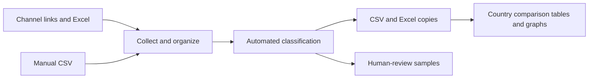

<a id="-pokémon-brand-analysis-project"></a>

<!-- readme-header32:start -->
<a name="pokémon-brand-analysis-project"></a>
<p align="center"></p>
<h1 align="center" id="project-title">Pokémon Brand Analysis Project</h1>
<p align="center">Brand-review classification and multilingual sentiment analysis</p>
<p align="center">
  <a href="../README.md"></a>
  <a href="README.md"></a>
</p>
<p align="center">
  <a href="../docs/%EC%9D%BD%EA%B8%B0%EC%95%88%EB%82%B4/%EB%A0%88%EB%B2%A81.md"></a>
  <a href="../docs/%EC%9D%BD%EA%B8%B0%EC%95%88%EB%82%B4/%EB%A0%88%EB%B2%A82.md"></a>
  <a href="../docs/%EC%9D%BD%EA%B8%B0%EC%95%88%EB%82%B4/%EB%A0%88%EB%B2%A83.md"></a>
  <a href="../docs/%EC%9D%BD%EA%B8%B0%EC%95%88%EB%82%B4/%EB%A0%88%EB%B2%A84.md"></a>
  <a href="../docs/%EC%9D%BD%EA%B8%B0%EC%95%88%EB%82%B4/%EB%A0%88%EB%B2%A85.md"></a>
</p>
<p align="center"><small>LEVEL links open the Korean source at the same reading level.</small></p>
<picture>
  <source media="(max-width: 600px) and (prefers-color-scheme: dark)" srcset="../assets/readme/flow-en-dark-mobile.svg" />
  <source media="(max-width: 600px)" srcset="../assets/readme/flow-en-light-mobile.svg" />
  <source media="(prefers-color-scheme: dark)" srcset="../assets/readme/flow-en-dark.svg" />
  <source media="(prefers-color-scheme: light)" srcset="../assets/readme/flow-en-light.svg" />
  
</picture>
<!-- readme-header32:end -->


This project classifies Pokémon-related reviews and content and visualizes sentiment-analysis results.

<!-- reading-levels17:start -->
| Reading level | What the guide covers |
| --- | --- |
| [LEVEL 1 - Beginner (Korean source)](../docs/%EC%9D%BD%EA%B8%B0%EC%95%88%EB%82%B4/%EB%A0%88%EB%B2%A81.md) | Unfamiliar terms and concrete examples from input to result |
| [LEVEL 2 - Explorer (Korean source)](../docs/%EC%9D%BD%EA%B8%B0%EC%95%88%EB%82%B4/%EB%A0%88%EB%B2%A82.md) | The relationships between key concepts and processing steps |
| [LEVEL 3 - Practitioner (Korean source)](../docs/%EC%9D%BD%EA%B8%B0%EC%95%88%EB%82%B4/%EB%A0%88%EB%B2%A83.md) | Experiment and usage procedures, and how to interpret results |
| [LEVEL 4 - Advanced (Korean source)](../docs/%EC%9D%BD%EA%B8%B0%EC%95%88%EB%82%B4/%EB%A0%88%EB%B2%A84.md) | Code structure, settings, design choices, and constraints |
| [LEVEL 5 - Expert (Korean source)](../docs/%EC%9D%BD%EA%B8%B0%EC%95%88%EB%82%B4/%EB%A0%88%EB%B2%A85.md) | Papers, protocols, denominators, leakage, and unverified scope |
<!-- reading-levels17:end -->

Field: Natural language processing › Sentiment and content classification › Rules, multilingual models, and human review

`Python`
`pandas`
`Jupyter`

[Quick start](#quick-start) · [Repository structure](#repository-structure) · [Data](#data-settings)

[All-revisions index (Korean source)](../docs/REVISION_INDEX.md) ·
[Core components](#input-processing-output)

<a id="-주요-개발-내용"></a>

## Implementation overview

The analysis compares purpose, messages, sentiment, behavioral intent, and topics across Pokémon channels in Korea, China, and Japan.

The YouTube key is optional in the base notebook; authentication conditions differ in the older Docker copy. Revision 2 organizes collection and classification.

- Channel Excel files, YouTube/homepage collection, and manual CSV inputs are connected, with manual-input templates and fallback workflows.
- Classification covers purpose, message type, behavioral intent, topics, and sentiment. The sampled comments are not guaranteed to represent all users' opinions.
- The notebooks include Excel-sheet output, country-level graphs and statistical comparisons, human-review samples, and a Cohen kappa calculation workflow.

**Materials:** [Revision 1 (Korean source)](../docs/versions/first.md) · [Revision 2 (Korean source)](../docs/versions/latest.md) · [Complete history (Korean source)](../docs/VERSIONS.md)

<a name="preview"></a>

<a name="input-processing-output"></a>

<a id="-입력처리출력"></a>

## Input, processing, and output

| Component | Description |
| --- | --- |
| Problem | Analyze differences in content types and responses across official country channels and comments. |
| Input | Brand reviews, Korean/Chinese/Japanese content, and manual CSV inputs |
| Processing | Rule-based or optional language-model classification, multilingual sentiment classification, statistics, and human review |
| Output | Classification CSV files, Excel files, and comparison graphs |

---

<a id="️-차수별-프로젝트-안내"></a>

## All revisions

| Revision or stage | Main content | Materials and comparison with the previous version |
| --- | --- | --- |
| <a id="layout18-table-3-row-1"></a> [Revision 1 (Korean source)](../docs/revisions/step-1.md) | A preceding analysis notebook that collects brand reviews and calculates promoter, neutral, and detractor proportions from ratings or sentiment scores.<br>Its experimental workflow used food-brand reviews as input. | [Folder](../1%EC%B0%A8)<br>[Full comparison](../docs/revisions/step-1.patch) |
| <a id="layout18-table-3-row-2"></a> [Revision 2 (Korean source)](../docs/revisions/step-2.md) | An analysis stage that collects homepages, social-media posts, and comments from Korea, China, and Japan, or supplements them with manual CSV data, then compares purpose, messages, sentiment, behavioral intent, and topics. | [Folder](../2%EC%B0%A8)<br>[Full comparison](../docs/revisions/step-2.patch) |


<a name="introduction"></a>

<a id="-프로젝트-소개"></a>

## Research method

This analysis project explores ways to compare brand reviews and Pokémon content.

The Revision 1 notebook connects review collection, ratings or sentiment scores, and social NPS calculation. The Revision 2 notebook collects content from Korean, Chinese, and Japanese channel links, saves classifications to CSV and copies of Excel files, and compares the results.

| Feature | Implementation |
| --- | --- |
| Review collection | Static web pages, boards, or manual CSV input |
| Content collection | Homepages, the YouTube API, and optional collection tools |
| Automated classification | Campaign purpose, message type, sentiment, behavioral intent, and topics |
| Sheet output | Copy the original Excel file and write results to the copy |
| Visualization | Data summaries, comparison tables, and graphs |
| Review support | Human-review samples and Cohen's κ calculation functions |



<a name="repository-structure"></a>

<a id="-저장소-구성"></a>

## Repository structure

```text
.
├── 1차/
│   └── brand_nps_auto_pipeline_v2.ipynb
├── 2차/
│   ├── 포켓몬30주년_올인원.ipynb
│   └── 포켓몬30주년_올인원_이전도커버전.ipynb
├── docs/VERSIONS.md
└── CHANGELOG.md
```

- [Brand-review analysis](../1차/brand_nps_auto_pipeline_v2.ipynb).
- [Korean, Chinese, and Japanese content analysis](../2차/포켓몬30주년_올인원.ipynb).
- [Previous Docker version](../2차/포켓몬30주년_올인원_이전도커버전.ipynb).
- [Version history (Korean source)](../docs/VERSIONS.md).

<a name="implementation"></a>

<a id="-주요-기술"></a>

## Main technologies

requests and BeautifulSoup read web materials, and pandas organizes tables. openpyxl writes Excel copies, while Matplotlib produces graphs. Optional workflows use yt-dlp, a multilingual sentiment model, and Playwright.

The original notebook treats automated classification as initial coding. Model/dictionary outputs are not equated with human-reviewed ground truth; review samples and classification agreement are checked together.

<a id="-실제-차수별-분석-방식"></a>

### Actual analysis methods by revision

Revision 1 is a preceding experiment using food-brand reviews. Actual ratings take priority when available; otherwise, keywords or the optional Gemini API estimate scores from 1~5. Scores of 4~5 are promoters, 3 is neutral, and 1~2 are detractors. The difference between two rounded proportions is calculated.

This is not a metric obtained directly from a 0~10 recommendation-intent survey.

The actual keyword-score ranges are total ≥5 → score 5, 2~4 → 4, -1~1 → 3, -4~-2 → 2, and all others → 1. These differ from an earlier explanatory table near the beginning of the notebook, so use the function's values.

The LLM workflow sends every review body to an external API. If an item still fails after retries and batch splitting, it receives score 3. These fallback classifications enter the aggregate, so distinguish failure counts from actual neutral responses in the original logs.

Revision 2 compares homepages, social-media posts, and comments across Korea, China, and Japan. It classifies 3 campaign purposes, 4 proposal types, insider/invitation-oriented messages, sentiment -1/0/1, behavioral intent O/X, and topics. The sentiment model is optional; loading failure switches to a dictionary method. Valid classification values in manual CSV data take priority.

The code and Markdown differences between the two Revision 2 notebooks concern the authentication environment variable and a duplicate declaration of the same start date.

The base file optionally reads `YOUTUBE_API_KEY` and skips YouTube if it is absent. The previous Docker copy stops with `KeyError` if `GOOGLE_API_KEY` is absent.

The “previous Docker” filename does not mean a separate container runtime is included.

<a name="quick-start"></a>

<a id="-빠른-시작"></a>

## Quick start

```powershell
python -m pip install jupyterlab requests beautifulsoup4 pandas openpyxl matplotlib scipy
python -m jupyter lab "2차/포켓몬30주년_올인원.ipynb"
```

1. Prepare the 6 original Excel files expected by the notebook and set `DATA_DIR`.
2. Check channel links and the collection period. YouTube collection requires your own `YOUTUBE_API_KEY`.
3. Use the CSV-input workflow under `manual/` for materials that do not support automated collection.
4. Prepare packages for the optional features you will use, then run collection → classification → sheet output → analysis.

The Revision 1 LLM workflow requires `GOOGLE_API_KEY` and `google-genai`. Check model availability and usage conditions in your execution environment. Revision 1 package setup and Revision 2 font setup include cells that attempt pip/apt installation; inspect the cells before running them.

To reanalyze already classified data, use the configuration cells and analysis section. Revision 2 includes its 6 input Excel files, preserved collection CSV files, review samples, and analysis outputs. Prepare your own API key for new collection, and separately specify review input for the Revision 1 analysis.

<a name="data-settings"></a>

<a id="-데이터-구성과-분석-설정"></a>

## Data and analysis settings

| Setting or output | Revision 2 default |
| --- | --- |
| Country order | Korea·China·Japan |
| Collection start | `2026-01-01` |
| End date | `None`: use the date at execution time |
| Videos per channel | Up to 100 |
| Comments per video | Up to 30 |
| Comment order | `relevance` |
| Classification output | `data/` |
| Excel copies | `수집결과/` |
| Manual input | `manual/` |

Limits, sorting, and available channels influence the sample. Revision 1 social NPS is calculated from review/sentiment scores; its measurement method differs from formal NPS based on a recommendation-intent survey.

<a id="-지표와-검수"></a>

### Metrics and human review

| Output or metric | Calculation and interpretation |
| --- | --- |
| Engagement rate | `(좋아요 + 댓글 + 공유) / 조회수 × 100` (likes + comments + shares, divided by views, ×100); zero/missing view counts are excluded |
| YouTube shares | Unavailable values are recorded as 0, distinct from an actual share count of 0 |
| Tables and graphs | 3 tables covering data summaries, key metrics, and statistical tests, plus 10 PNG graphs |
| Behavioral-intent interval | Country proportions and 95% Wilson confidence intervals |
| Categorical comparison | Chi-square and Cramér's V, with warnings for small expected counts |
| Distribution comparison | Kruskal–Wallis·ε² and country-pair Mann–Whitney U tests with Bonferroni correction |
| Association | Spearman correlation between post engagement and mean comment sentiment |
| Review samples | Up to 50 comments per country, and up to 14 posts and 14 homepage items per country |

Fill in the `human_*` columns manually before calculating Cohen's κ. Default post and homepage samples contain 14 items per country, each up to 42 overall; actual counts can be smaller depending on available data. For partially reviewed files, valid-pair denominators for κ and agreement rates may differ, so inspect the sample.

<a id="-수집과-재실행의-한계"></a>

### Collection and rerun limitations

This is a non-probability sample focused on official channels and comments sorted by relevance. It neither represents all consumers in each country nor establishes causality.

Homepages do not receive the same period filter as social-media content. A failed robots.txt lookup is treated as permission. URL normalization changes letter case, so check links involving case-sensitive post identifiers.

Original Excel files are copied, but output Excel/CSV files and review samples with the same names are rewritten on rerun. Preserve manually reviewed files separately before execution.

<a name="troubleshooting"></a>

<a id="️-문제-해결"></a>

## Troubleshooting

| Symptom | What to check |
| --- | --- |
| Excel file not found | `DATA_DIR`, input files, and sheet structure |
| YouTube collection fails | API key, service configuration, and quota |
| Web collection is empty | Page structure, JavaScript rendering, and access conditions |
| A channel cannot be collected | Official API support and the manual CSV workflow |
| Unexpected sentiment results | Whether a model or dictionary fallback was used, and human-review samples |
| Korean graph text is incorrect | Font installation and notebook font settings |

---

Record collection conditions, review automated classifications, and compare the results.

<a id="-원문-수집분석-자료"></a>

## Original collection and analysis materials

| Material | Open |
| --- | --- |
| Collected raw data and review samples | [All CSV files](../2차/data/) |
| Completed country sheets | [Collection-result Excel files](../2차/수집결과/) |
| Combined analysis | [Results workbook](../2차/결과/분석결과_통합.xlsx) |
| Comparisons by condition and country | [10 experiment graphs](../2차/결과/figures/) |

These materials describe classifications and preserved collection times. They contain original comments and posts; distinguish automated classification from human review. The country/platform composition of the collected sample differs from a survey designed to represent all users' opinions.

<a name="research-details"></a>

<a id="-연구구현의-세부-흐름"></a>

## Methods and conditions by revision

Inputs, processing methods, execution conditions, and results are organized by revision.

<a id="-1차--리뷰-감성과-소셜-nps-파이프라인"></a>

<details>
<summary>Revision 1 · Review sentiment and social NPS pipeline</summary>

<a id="1차리뷰-감성과-소셜-nps-파이프라인"></a>

A preceding analysis notebook that collects brand reviews and calculates promoter, neutral, and detractor proportions from ratings or sentiment scores. Its experimental workflow used food-brand reviews as input.

| Component | Processing |
| --- | --- |
| Review collection | requests, BeautifulSoup, and page rules locate reviews and ratings. |
| Keyword scores | Weighted keyword totals and simple negation rules produce scores from 1~5. |
| Optional LLM | A separate workflow obtains sentiment scores through Gemini batch requests, retries, and batch splitting. |
| Social NPS | Scores 4~5 are promoters, 3 is neutral, and 1~2 are detractors; the difference between their proportions is calculated. |

| Input or condition | Description |
| --- | --- |
| Base environment | pandas·requests·BeautifulSoup·Matplotlib·Jupyter |
| Optional model | google-genai and your own GOOGLE_API_KEY |
| Score ranges | Total ≥5 → score 5, 2~4 → 4, -1~1 → 3, -4~-2 → 2, otherwise 1 |
| Classification | 4~5 promoter·3 neutral·1~2 detractor |

The keyword function's score ranges differ in places from the notebook's earlier explanatory table; use the actual function. Weighting focuses on the first occurrence found rather than the full count of repeated keywords.

The LLM workflow sends review text to an external API and assigns score 3 to items that still fail after retries and batch splitting. Check both how this fallback mixes with neutral responses and how the metric subtracts rounded proportions.

| Constraint | What to check |
| --- | --- |
| Metric definition | This is not NPS obtained directly from a formal recommendation-intent survey. |
| Fallback value | Distinguish API-failure score 3 from actual neutral ratings. |
| Collection conditions | Page structure, selected samples, and the availability of ratings influence results. |
| Installation cells | Identify package-installation and external-API cells before execution. |

[Files, key definitions, and usage order (Korean source)](../docs/revisions/step-1.md) · [Full comparison for this stage](../docs/revisions/step-1.patch)

<a id="-2차--한중일-포켓몬-콘텐츠-비교"></a>

</details>

<details>
<summary>Revision 2 · Comparing Korean, Chinese, and Japanese Pokémon content</summary>

<a id="2차한중일-포켓몬-콘텐츠-비교"></a>

This stage collects homepages, social-media posts, and comments from Korea, China, and Japan, or supplements them through manual CSV inputs, then compares purpose, messages, sentiment, behavioral intent, and topics.

| Component | Processing |
| --- | --- |
| <a id="layout18-table-12-row-1"></a> Input and collection | Connect 6 original Excel files, YouTube, homepages, and manual CSV data. |
| <a id="layout18-table-12-row-2"></a> Classification | Organize 3 purposes, 4 proposal types, insider/invitation-oriented messages, sentiment -1/0/1, behavioral intent O/X, and topics. |
| <a id="layout18-table-12-row-3"></a> Sheets and analysis | Produce CSV/Excel copies and country graphs, with chi-square, Kruskal–Wallis, and correlation analyses. |
| <a id="layout18-table-12-row-4"></a> Human review | Create samples for filling human columns and provide functions for Cohen κ and agreement rates. |


| Input or condition | Description |
| --- | --- |
| Period | START_DATE=2026-01-01·END_DATE=None |
| Collection limits | 100 videos per channel·30 comments per video·relevance sorting |
| Base-file authentication | Skip YouTube collection if YOUTUBE_API_KEY is absent |
| Docker-named copy | Stop during initialization if GOOGLE_API_KEY is absent |
| Output locations | data/·수집결과/·결과/·manual/ |

These are row counts in the preserved data and review-sample files.

| Material | Preserved data | Review-sample file |
| --- | --- | --- |
| Comments | 5585 rows | 100 rows |
| Posts | 400 rows | 28 rows |
| Homepages | 73 rows | 35 rows |

The number of rows in a review-sample file is not the number of items whose human review has been completed.

Engagement is (likes + comments + shares)/views ×100. Unavailable YouTube share counts are recorded as 0. Read Wilson intervals, chi-square/Cramér V, Kruskal–Wallis/ε², Mann–Whitney/Bonferroni, and Spearman results together with the sample and valid-item counts.

| Constraint | What to check |
| --- | --- |
| <a id="layout18-table-15-row-1"></a> Representativeness | This non-probability sample focuses on official channels and relevance-ranked comments; do not generalize it to all consumers in a country. |
| <a id="layout18-table-15-row-2"></a> Collection and normalization | Homepage period filtering, permissive handling of failed robots lookups, and URL lowercasing affect sample composition and links. |
| <a id="layout18-table-15-row-3"></a> Classification fallback | Failed sentiment-model loading switches to a dictionary method, and existing manual classifications take priority. |
| <a id="layout18-table-15-row-4"></a> Reruns | CSV/Excel files and review samples with the same names are rewritten; preserve human-completed files separately. |


[Files, key definitions, and usage order (Korean source)](../docs/revisions/step-2.md) · [Full comparison for this stage](../docs/revisions/step-2.patch)

[Changes to the revision guides (Korean source)](../docs/changes/2026-11-03-%EC%B0%A8%EC%88%98%EB%B3%84%ED%94%84%EB%A1%9C%EC%A0%9D%ED%8A%B8%EC%95%88%EB%82%B4.md)

</details>
